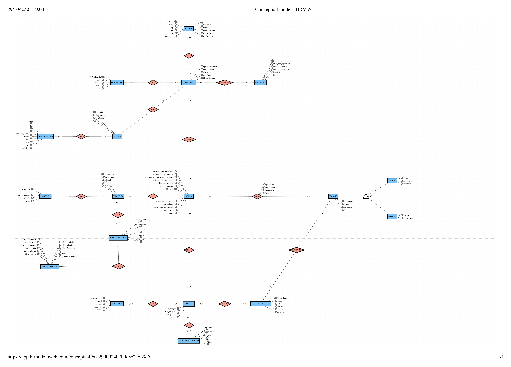

# Entrega 2 — Modelo Lógico, Implementação SQL e Apresentação Final

### Modelagem de um sistema de gestão de informações para uma organização de pequeno porte

**Organização estudada: Ótica Kadosh** · Projeto acadêmico de Modelagem de Dados

## Integrantes

| Nome completo do aluno | RGM | Usuário do GitHub |
| --- | --- | --- |
| Victor Augusto Silva Marcilio | 47190175 | [Victordev14](https://github.com/Victordev14) |
| João Felipe de Sousa Pires | 48165379 | [jfpiresoficial](https://github.com/jfpiresoficial) |
| Cauã Batista Freire | 48355127 | [cauabf-prev](https://github.com/cauabf-prev) |
| João Victor Gobi Romero | 48114642 | [joaovromero](https://github.com/joaovromero) |
| Guilherme Araujo de Oliveira | 47116862 | [GK-300](https://github.com/GK-300) |

**Artefatos do repositório:** [Dicionário de dados (HTML)](./Dicionario_de_Dados_Otica_Kadosh.html) · [Levantamento](./levantamento/levantamento.md) · [DER revisado](./DER_OticaKadosh.png) · modelo lógico, script SQL e massa de dados (nas próximas partes).

---

## 1.1 Revisão do Modelo Conceitual (Caso A — mesma organização da Entrega 1)

### Caracterização da organização

**Nome e natureza.** **Ótica Kadosh**, comércio **com fins lucrativos** que vende armações e lentes, no endereço Av. Diogo da Costa Tavares, 125, Jardim Romano, São Paulo/SP, CEP 08191-000. É a mesma organização da Entrega 1; o grupo mantém acesso a ela, inclusive para voltar a campo e validar regras e volumes.

**Contexto e porte.** Pequeno comércio com **3 funcionários**: um optometrista, um gerente e um consultor óptico. O gerente informou cerca de **100 atendimentos e 80 vendas por semana**. A ótica atende presencialmente, recebe pagamentos à vista, parcelados ou em partes, mantém estoque, compra de fornecedores quando falta produto e trata trocas e devoluções.

Os números abaixo dimensionam a massa de dados (seção 4). A coluna **Origem** separa o que o gerente informou do que o grupo estimou. As estimativas são valores fictícios definidos pelo grupo, por orientação do professor, e **não foram confirmadas pela ótica**.

| Indicador | Valor | Origem |
| --- | --- | --- |
| Funcionários | 3 (optometrista, gerente, consultor óptico) | Informado pelo gerente |
| Atendimentos por semana | ≈ 100 (≈ 430 por mês) | Informado pelo gerente |
| Vendas por semana | ≈ 80 (≈ 345 por mês) | Informado pelo gerente |
| Conversão de atendimento em venda | ≈ 80% | Calculado: 80 ÷ 100 |
| Estoque mínimo | 100 pares de lentes e 500 armações (RN-34) | Informado pelo gerente |
| Clientes ativos (com atendimento nos últimos 12 meses) | ≈ 1.800 | Estimativa fictícia do grupo |
| Orçamentos por semana | ≈ 90 (toda venda tem orçamento, RN-23, e alguns não viram venda) | Estimativa fictícia do grupo |
| Vendas parceladas | ≈ 35% das vendas (≈ 120 por mês) | Estimativa fictícia do grupo |
| Pagamentos por mês | ≈ 800 (345 sinais ou pagamentos integrais + ≈ 4 parcelas por venda parcelada) | Calculado a partir das estimativas |
| Itens em estoque | ≈ 900 armações e ≈ 250 pares de lentes, em ≈ 350 produtos cadastrados | Estimativa fictícia do grupo (acima do mínimo da RN-34) |
| Fornecedores ativos | ≈ 6 | Estimativa fictícia do grupo |
| Compras a fornecedores | ≈ 12 por mês | Estimativa fictícia do grupo |
| Trocas e devoluções | ≈ 15 por mês (≈ 4% das vendas) | Estimativa fictícia do grupo |

**Problemas e necessidades.** Hoje pedidos, estoque e parcelas ficam em **papel e planilhas separadas**, e um banco de dados usado antes na loja falhava com frequência. Cada problema abaixo é de gestão de informações, aparece no DER e terá ao menos uma consulta gerencial no script SQL (rastreabilidade na seção 1.6).

| Código | Problema | Onde aparece no DER | Requisitos que o resolvem |
| --- | --- | --- | --- |
| P1 | Pedidos, receitas e pagamentos ficam em papel e planilhas separadas, sem vínculo seguro entre atendimento, orçamento, venda e pagamento; cada consulta exige abrir vários registros. | CLIENTE, ATENDIMENTO, RECEITA, ORCAMENTO, VENDA, PAGAMENTO, PARCELA | RF-01, RF-02, RF-05, RF-06, RF-07, RF-08, RF-17 |
| P2 | O saldo de estoque de armações e lentes não é controlado com segurança, e a loja não sabe quando está abaixo do mínimo (RN-34). | PRODUTO, ESTOQUE, COMPRA, FORNECEDOR | RF-10, RF-11, RF-12 |
| P3 | A garantia não é controlada por produto vendido: um ano para armação e seis meses para lente, contados da montagem (RN-07). | VENDA, CONTÉM, PRODUTO, LENTE, ARMACAO | RF-13, RF-14 |
| P4 | A conversão de atendimentos em vendas não é medida (≈ 100 atendimentos e ≈ 80 vendas por semana). | ATENDIMENTO, VENDA | RF-02, RF-06, RF-18 |
| P5 | Os dados de saúde das receitas precisam de proteção, e lente de grau só é vendida com receita (RN-16). | RECEITA, RECEITA_MEDIDA, ATENDIMENTO, LENTE | RF-03, RF-04, RF-19 |

**Escopo do sistema.** O banco reúne todos os dados da ótica, e não só os dos problemas acima: clientes, equipe, atendimentos (inclusive manutenção sem venda), receitas e medidas, orçamentos, vendas e suas linhas, pagamentos, parcelas, notas fiscais de saída e de entrada, fornecedores, compras, produtos (lentes e armações), estoque e pós-venda.

**Justificativa da escolha.** A ótica tem processos encadeados e observáveis (atendimento, receita, orçamento, venda, pagamento, compra, montagem, retirada, garantia e troca), que pedem relacionamentos variados: 1:1, 1:N, N:N com atributos e generalização/especialização. O grupo tem acesso presencial à loja e ao gerente. **Vínculo com a organização:** nenhum integrante do grupo trabalha na ótica nem tem vínculo familiar com seus responsáveis.

**Evidências da organização.**

- Endereço completo: Av. Diogo da Costa Tavares, 125, Jardim Romano, São Paulo/SP, CEP 08191-000.
- Forma de contato: telefone da loja, (11) 99349-4371.
- Perfil no Google Meu Negócio (Google Maps, "Óticas kadosh"): [abrir o perfil](https://www.google.com/maps/place/%C3%93ticas+kadosh/@-23.4853128,-46.3896531,17z/data=!3m1!4b1!4m6!3m5!1s0x94ce63a88cc3646f:0x458e7b7ae1e2b7bb!8m2!3d-23.4853177!4d-46.3870782!16s%2Fg%2F11qwsc5n75).
- Foto da visita, dentro da loja, com o letreiro "Ótica Kadosh" na parede: [`Otica kadoshi.jpeg`](./Otica%20kadoshi.jpeg). Da esquerda para a direita: Kaique Batista dos Santos (consultor óptico), Guilherme de Souza Silva (optometrista), **Marcos Vinícius Silva Menezes (gerente, o entrevistado)**, Victor Augusto Silva Marcilio, João Felipe de Sousa Pires e Cauã Batista Freire (integrantes do grupo).
- As fotos do formulário de pedido e do laudo mostram dados pessoais e de saúde de clientes reais e **não foram publicadas**.

**Responsável pela organização.** Marcos Vinícius Silva Menezes, **gerente**, que atendeu o grupo. Contato pelo telefone da loja: (11) 99349-4371.

### Relato da entrevista

- **Quem:** o entrevistado foi Marcos Vinícius Silva Menezes, gerente. Participaram os integrantes Cauã Batista Freire, João Felipe de Sousa Pires e Victor Augusto Silva Marcilio.
- **Quando e onde:** 05/09/2026, presencialmente, dentro da Ótica Kadosh.
- **Comprovação:** a foto [`Otica kadoshi.jpeg`](./Otica%20kadoshi.jpeg), tirada no interior da loja durante a visita.
- **Depois da visita:** o gerente respondeu por mensagem a dúvidas pontuais do grupo em 14/10/2026 e 15/10/2026 (garantia, desistência, venda sem receita, medidas por olho, parcelamento, validade do orçamento, unidade de lentes e armações) e informou depois que a ótica emite nota fiscal a cada pagamento recebido. Foram confirmações por mensagem, e não uma nova visita.
- **O que mudou desde a Entrega 1:** nome, endereço, contato e responsável passaram a constar no relatório; os processos viraram sequências com entrada, responsável e saída; entraram as notas fiscais de saída e de entrada; o DER foi revisado (tabela do Caso A, abaixo).

**O que o grupo observou na loja** (separado do que foi dito):

| Observado no local | Efeito no modelo |
| --- | --- |
| O formulário de pedido preenchido na venda, com os campos do cliente, da compra, da receita e do pagamento | Atributos de CLIENTE, VENDA, CONTÉM, PAGAMENTO |
| O comprovante (canhoto de compra e venda) entregue ao cliente | VENDA.canhoto_conferido; RN-21 |
| O laudo produzido na ótica pelo optometrista | RECEITA e RECEITA_MEDIDA |
| Pedidos, estoque e parcelas anotados em papel e em planilhas separadas | Problemas P1 e P2 |

**O que o gerente informou:** porte e rotina (3 funcionários, ≈ 100 atendimentos e ≈ 80 vendas por semana, banco de dados anterior com falhas), regras de receita (RN-03, RN-09, RN-16), garantia (RN-07, RN-19), suporte gratuito (RN-20), retirada com canhoto (RN-21), nota fiscal (RN-22), desistência (RN-24), troca e devolução (RN-08, RN-25), parcelamento (RN-17), encomenda (RN-18), orçamento (RN-23), unidade de lentes e armações (RN-26) e estoque mínimo (RN-34).

**Não confirmado:** o regulamento de garantia não foi apresentado; as regras de nota fiscal e reembolso são relatos do gerente, e não parecer jurídico; tipos de dados, tamanhos, índices e prazos de retenção do dicionário são propostas do grupo.

O levantamento completo está em [`levantamento/levantamento.md`](./levantamento/levantamento.md).

### Processos de negócio

Os 12 processos foram mapeados na ótica e conferidos com o gerente. Cada um cita os dados envolvidos.

| ID | Processo | Entrada | Sequência e responsável | Saída e integração |
| --- | --- | --- | --- | --- |
| PR01 | Cadastro e atendimento | Cliente procura a loja. | Funcionário consulta ou cadastra o CLIENTE (nome, data de nascimento, CPF, e-mail, telefones, endereço) e registra o ATENDIMENTO (data e hora, meio de contato, tipo COMERCIAL, AVALIACAO ou MANUTENCAO). | Histórico do cliente, mesmo sem venda. |
| PR02 | Receita e medidas | Receita trazida ou avaliação interna. | Optometrista (laudo) ou consultor (receita trazida) registra a RECEITA (data, origem TRAZIDA ou LAUDO_OTICA, observação) no atendimento e as medidas por olho (OD/OE) e distância (LONGE/PERTO): esférico, cilíndrico, eixo, acuidade visual, DNP e altura. | Prescrição acessível pelo atendimento, com acesso restrito. |
| PR03 | Orçamento | Cliente escolhe armação e lente. | Consultor registra o ORCAMENTO (emissão, validade de 24 horas, status, observação) e a aprovação do cliente. | Oferta preservada mesmo sem venda. |
| PR04 | Venda | Orçamento aprovado e válido. | Consultor registra a VENDA no mesmo atendimento (data e hora, total, status, observação) com as linhas de CONTÉM (número da linha, produto, quantidade, preço unitário, observação). | Pedido comercial rastreável, com receita quando exigida. |
| PR05 | Sinal e parcelas | Condição de pagamento acordada. | Consultor registra o PAGAMENTO (valor, data, forma, finalidade) e as PARCELAS do saldo (número, valor, vencimento). Pagamento posterior quita uma parcela. | Plano do saldo sem duplicação do sinal. |
| PR06 | Compras e fornecedores | Reposição ou necessidade de uma venda. | Gerente registra a COMPRA ao FORNECEDOR (data do pedido, chegada, status), com venda de origem opcional, e a NOTA_FISCAL_ENTRADA recebida. | Compra pode existir sem venda; o recebimento gera entrada no estoque. |
| PR07 | Estoque | Compra recebida, venda executada ou pós-venda aceito. | Registrar o movimento em ESTOQUE (data, quantidade, direção, motivo, condição) para um PRODUTO. | Saldos disponível e segregado calculados sem dupla baixa. |
| PR08 | Encomenda e montagem | Sinal de pelo menos 30% e previsão informada. | Registrar previsão de conclusão, liberação, envio ao fornecedor e montagem/finalização. | Datas previstas e realizadas preservadas; início da garantia. |
| PR09 | Retirada | Óculos prontos e canhoto apresentado. | Conferir o canhoto e registrar a retirada efetiva (data e conferência). | Entrega registrada; previsão não se confunde com realização. |
| PR10 | Manutenção | Pedido de ajuste após a entrega. | Registrar ATENDIMENTO de manutenção e a descrição do serviço (gratuito, RN-20). | Histórico do suporte gratuito. |
| PR11 | Troca, devolução e garantia | Solicitação sobre produto vendido. | Registrar a TROCA_DEVOLUCAO (tipo, data do ocorrido, quantidade afetada, dano, parecer, data de avaliação, decisão, valores cobrado, abatido e reembolsado), com a nota fiscal de saída de origem, e os movimentos de ESTOQUE. | Retorno, substituição e descarte rastreados; recusas preservadas. |
| PR12 | Cancelamento e nota fiscal | Desistência do cliente ou pagamento recebido. | Registrar na VENDA o envio ao fornecedor e a solicitação de cancelamento; registrar a NOTA_FISCAL_SAIDA (número, data, valor total, tributos) de **cada** PAGAMENTO recebido. | Decisão auditável e nota fiscal registrada; sem integração com o Fisco. |

**Processos comuns em óticas que ficaram de fora.** Foram levantados com apoio de IA, a partir do que óticas costumam fazer (registrado na seção 6). A coluna de justificativa é uma **proposta do grupo, a confirmar com o gerente** na próxima visita.

| Processo comum | Por que não foi incluído |
| --- | --- |
| Agendamento de consultas | Não foi relatado. O atendimento é presencial e o DER registra só o atendimento realizado. |
| Laboratório externo e ordem de serviço | Não confirmado; o levantamento indicou envio do pedido ao fornecedor, registrado em VENDA. |
| Fidelidade, campanhas e CRM | Não relatado e não ligado aos problemas P1 a P5. |
| Caixa diário e conciliação com a operadora do cartão | Não relatado; o sistema registra o pagamento recebido, e não o repasse da operadora. |
| Emissão fiscal integrada (NF-e/NFC-e) | A nota é emitida em sistema externo; o banco só registra os dados da nota. |
| Folha, ponto, escala e comissões | Equipe de 3 pessoas; não relatado. |
| Convênios e planos de saúde | Não relatado. |

### Requisitos

Os requisitos abaixo foram reescritos com os dados envolvidos e correspondem aos processos acima. A cobertura dos problemas está na coluna **Problema**.

**Requisitos funcionais**

| ID | O sistema deve permitir | Processo | Problema |
| --- | --- | --- | --- |
| RF-01 | Cadastrar e consultar clientes com nome completo, data de nascimento, CPF, e-mail, telefone fixo, celular e endereço (logradouro, número, bairro, cidade, CEP), exigindo ao menos um meio de contato. | PR01 | P1 |
| RF-02 | Registrar atendimentos com data e hora, meio de contato, tipo (COMERCIAL, AVALIACAO ou MANUTENCAO), descrição do serviço (na manutenção), cliente e funcionário responsável, inclusive atendimentos sem venda. | PR01, PR10 | P1, P4 |
| RF-03 | Registrar receita (data, origem, observação) e, por olho e distância, esférico, cilíndrico, eixo, acuidade visual, DNP e altura, com de uma a quatro medidas por receita. | PR02 | P5 |
| RF-04 | Conferir se a venda de lente com grau (possui grau) tem receita no mesmo atendimento. | PR02, PR04 | P5 |
| RF-05 | Emitir e guardar orçamentos com data e hora de emissão, validade (24 horas), aprovação, status e observação, preservando os não aprovados. | PR03 | P1 |
| RF-06 | Registrar venda com data e hora, total, status, observação e, por linha, número da linha, produto, quantidade, preço unitário e observação. | PR04 | P1, P4 |
| RF-07 | Registrar pagamentos com valor, data, forma (PIX, DINHEIRO, DEBITO, CREDITO) e finalidade (SINAL, INTEGRAL, PARCIAL, QUITACAO_PARCELA), sem exceder o saldo devido, e emitir/registrar a nota fiscal de saída de cada pagamento com número, data de emissão, valor total e tributos. | PR05, PR12 | P1 |
| RF-08 | Registrar as parcelas do saldo (número de 1 a 10, valor mínimo de R$ 50,00, vencimento, status) e a quitação por pagamento. | PR05 | P1 |
| RF-09 | Cadastrar fornecedores (nome, CNPJ, endereço, contato) e compras (data do pedido, chegada, status, venda de origem opcional), e registrar a nota fiscal de entrada (número, data de emissão, valor total, tributos). | PR06 | P2 |
| RF-10 | Cadastrar produtos (tipo, referência, marca, unidade) com as características de lente (índice, tratamento, possui grau) ou de armação (tipo, material). | PR04, PR07 | P2, P3 |
| RF-11 | Registrar movimentos de estoque (data, quantidade, direção, motivo, condição, produto, compra de origem) e consultar o saldo por produto e condição. | PR07 | P2 |
| RF-12 | Indicar produtos cujo saldo disponível está abaixo do mínimo de 100 pares de lentes ou 500 armações (RN-34). | PR07 | P2 |
| RF-13 | Registrar previsão de conclusão, liberação da encomenda, envio ao fornecedor, montagem/finalização, horário previsto, retirada efetiva e conferência do canhoto. | PR08, PR09 | P1 |
| RF-14 | Calcular a garantia por produto vendido a partir da montagem: um ano para armação e seis meses para lente. | PR08, PR11 | P3 |
| RF-15 | Registrar troca ou devolução com tipo, data do ocorrido, status, quantidade afetada, dano, parecer, data de avaliação, valores cobrado, de abatimento e reembolsado, e a nota fiscal de saída de origem, com os movimentos de estoque correspondentes. | PR11 | P3 |
| RF-16 | Registrar o envio do pedido ao fornecedor e a solicitação de cancelamento por desistência, preservando a decisão. | PR12 | P4 |
| RF-17 | Consultar o histórico integrado de um cliente: atendimentos, receitas, orçamentos, vendas, pagamentos e parcelas. | PR01 a PR05 | P1 |
| RF-18 | Consultar a conversão de atendimentos em vendas por período e por funcionário. | PR01, PR04 | P4 |
| RF-19 | Controlar o acesso por função (gerente, consultor óptico, optometrista) e auditar leituras de receitas e alterações. | Todos | P5 |

**Requisitos não funcionais**

| ID | Característica | Critério proposto |
| --- | --- | --- |
| RNF-01 | Segurança e privacidade | Acesso individual e por função, com o mínimo necessário; proteção dos dados de saúde (LGPD). |
| RNF-02 | Integridade | Validar identificadores, vínculos, totais (soma das linhas igual ao total da venda) e saldos. |
| RNF-03 | Recuperação | Cópia de segurança diária e teste periódico de restauração; infraestrutura a definir com a loja. |
| RNF-04 | Usabilidade | Localizar cliente, histórico e situação do pedido em uma única consulta; validar com a equipe. |
| RNF-05 | Rastreabilidade | Registrar autor, instante, operação, objeto e resultado; proteger os registros de auditoria. |
| RNF-06 | Desempenho | Índices para consultas por cliente, período e produto; medir na implementação, sem meta não validada. |
| RNF-07 | Disponibilidade | Operar no horário de atendimento da loja; níveis de serviço ainda não contratados. |

**Requisitos comuns que ficaram de fora** (justificativas propostas pelo grupo, a confirmar com o gerente):

| Requisito comum | Por que não foi incluído |
| --- | --- |
| Agendamento online e lembretes por mensagem | A ótica não faz agendamento; o aviso de que o óculos ficou pronto é feito pelo celular do cliente (campo cadastrado), fora do sistema. |
| Emissão de NF-e/NFC-e dentro do sistema | A nota é emitida em sistema externo; o banco registra apenas os dados dela (RN-22). |
| Controle de custo e itens da compra | O DER final do grupo não tem entidade ou relacionamento de itens da compra; é uma **limitação declarada** do modelo, a avaliar com o gerente. |
| Folha, escala e comissão | Equipe de 3 pessoas; não relatado. |
| Aplicativo ou site para o cliente | Não é problema de gestão de informações e não foi relatado. |

### Regras de negócio

Os códigos da Entrega 1 foram mantidos. **RN-31 e RN-32** foram retiradas porque dependiam de relacionamentos que não constam do DER final; os códigos não foram reutilizados. **RN-22 foi alterada** (a ótica emite nota fiscal a cada pagamento recebido) e **RN-35** foi criada.

| ID | Regra | Origem |
| --- | --- | --- |
| RN-01 | Toda venda pertence a um atendimento; um atendimento pode não resultar em venda e resulta em no máximo uma. | Levantamento e DER |
| RN-02 | A receita é obtida pelo atendimento da venda, sem ligação direta RECEITA–VENDA. Quando exigida, deve pertencer ao mesmo atendimento e cliente; a prescrição daquele pedido não é reutilizada em outro pedido. | Levantamento; ajuste do professor |
| RN-03 | A ótica aceita receita trazida com até um ano da emissão na data de aceitação do pedido; caso contrário, realiza novo teste. Trata-se de prática relatada, sem definir validade legal geral. | Entrevista |
| RN-04 | Os preços são por armação e por par de lentes. O total original da venda é a soma das quantidades multiplicadas pelos preços das linhas de CONTÉM. | Formulário e entrevista |
| RN-05 | A venda pode ter pagamentos em momentos diferentes. PAGAMENTO representa recebimento; PARCELA representa compromisso futuro. | Entrevista e modelagem |
| RN-06 | A venda pode usar estoque e não gerar compra. COMPRA possui um fornecedor e pode atender uma venda ou repor estoque sem venda de origem. | Confirmação do grupo e DER final |
| RN-07 | A garantia comercial relatada começa na montagem/finalização: um ano para armação e seis meses para lente; calcular por produto vendido. | Entrevista |
| RN-08 | Em troca ou devolução aceita, peças intactas podem ser reaproveitadas e peças sem reaproveitamento são descartadas, com movimentos separados. | Entrevista |
| RN-09 | Venda sem lente de grau pode não possuir receita, como no caso relatado de óculos de sol sem grau. | Resposta do gerente |
| RN-10 | Cada receita possui de uma a quatro medidas: uma por combinação de OD/OE e LONGE/PERTO. A chave composta impede combinação repetida; validar o mínimo ao concluir o cadastro. | Laudo e modelagem |
| RN-11 | Recebimentos não devem exceder o saldo devido. Pagamentos originais são preservados; cobranças, abatimentos e restituições autorizados são conciliados separadamente. | Decisão técnica de integridade |
| RN-12 | Movimentos têm quantidade positiva, direção, condição e motivo compatíveis. Saída não pode exceder o saldo da condição movimentada; retorno, substituição e descarte não repetem a baixa original. | Modelagem do estoque |
| RN-13 | DNP e altura são registradas por olho. Se repetidas entre longe e perto para o mesmo olho, manter coerência, salvo diferenciação validada pelo responsável. | Resposta do gerente e decisão técnica |
| RN-14 | PRODUTO tem especialização total e disjunta: todo produto é LENTE ou ARMACAO, nunca os dois. Os subtipos herdam id_produto. | Nota do DER |
| RN-15 | O optometrista emite o laudo interno; o consultor conduz o atendimento comercial que fecha a venda. O DER não registra o emissor do laudo; o responsável pelo atendimento é obtido por CONDUZ. | Respostas do gerente; DER final |
| RN-16 | Lente com possui_grau verdadeiro exige receita no atendimento da venda, trazida pelo cliente ou emitida internamente. | Resposta do gerente |
| RN-17 | Depois do sinal, o saldo pode ser parcelado no cartão em até dez parcelas de no mínimo R$ 50,00; o sinal não integra essas parcelas. | Confirmação de 15/10/2026 |
| RN-18 | Encomenda só é liberada após recebimento de sinal de pelo menos 30% do total e registro da previsão de conclusão. Uma venda aberta pode existir antes desse recebimento. | Resposta do gerente |
| RN-19 | Segundo o gerente, a garantia da armação cobre defeito de fabricação, mola e parafuso; a da lente cobre adaptação, erro de grau, eficácia do tratamento e arranhões, conforme regulamento da ótica. O regulamento não foi apresentado ao grupo. | Relato de 14/10/2026 |
| RN-20 | O suporte relatado após a entrega é gratuito e vitalício para ajustes, plaquetas e parafusos; registrar como atendimento de manutenção. | Resposta do gerente |
| RN-21 | A entrega é feita ao portador do canhoto de compra e venda; registrar a conferência ao preencher a retirada efetiva. | Resposta do gerente |
| RN-22 | A ótica emite uma nota fiscal a cada pagamento recebido (sinal, parcela ou pagamento integral). Registrar em NOTA_FISCAL_SAIDA o número, a data de emissão, o valor total e os tributos, vinculada ao PAGAMENTO que a originou (GERA): todo pagamento tem exatamente uma nota e cada nota pertence a um único pagamento. Toda TROCA_DEVOLUCAO referencia a nota fiscal de saída da venda original (REFERE-SE A), e uma nota pode ser referenciada por várias ocorrências. O relato do gerente sobre a emissão a cada pagamento não constitui validação fiscal ou jurídica. | Relato do gerente; DER final (27/10/2026) |
| RN-23 | Toda venda, inclusive pronta entrega, é precedida de orçamento. Orçamentos são guardados mesmo sem venda, com emissão e validade usual de 24 horas. A venda só é feita com aprovação dentro da validade. O DER não liga ORCAMENTO diretamente a VENDA. | Confirmações do grupo; DER final |
| RN-24 | Na desistência sem defeito, a política comercial relatada considera o pedido ainda não enviado ao fornecedor e o limite de 24 horas da compra. Solicitação não significa cancelamento automático; preservar a decisão. | Relato de 15/10/2026 |
| RN-25 | Troca depende de avaliação do produto e causa do dano, podendo ser aprovada ou recusada. Parecer e data são exigidos na decisão; não presumir política de reembolso ou crédito. | Resposta do gerente |
| RN-26 | Lentes são compradas, vendidas e contadas por par; armações por unidade. | Confirmação de 15/10/2026 |
| RN-27 | O campo “A partir das” é horário previsto de retirada. O índice de refração registra o valor numérico; observações da linha descrevem características adicionais da lente. | Formulário e resposta do gerente |
| RN-28 | PARCELA possui id_parcela próprio. QUITA é opcional e 1:1: um pagamento quita no máximo uma parcela e cada parcela é quitada por no máximo um pagamento. | DER final |
| RN-29 | CONTÉM distingue linhas por numero_linha único dentro da venda. O mesmo produto pode ocorrer em duas linhas com preços diferentes. | Confirmação do usuário e nota do DER |
| RN-30 | Todo movimento de ESTOQUE refere-se a um produto (É MOVIMENTADO EM); a entrada por compra liga-se à COMPRA de origem (GERA ENTRADA). Os demais motivos (venda, retorno, substituição, descarte) são registrados no atributo motivo. | DER final |
| RN-33 | Campos de reembolso e abatimento registram apenas acertos efetivamente autorizados; não comprovam que a loja oferece essas alternativas em todos os casos. | Limite do levantamento e campos do DER |
| RN-34 | A loja mantém no mínimo 100 pares de lentes e 500 armações em estoque; abaixo disso, precisa repor. As lentes são contadas por par (RN-26). | Resposta do gerente |
| RN-35 | A nota fiscal de entrada, emitida pelo fornecedor, é registrada em NOTA_FISCAL_ENTRADA e vinculada à COMPRA (POSSUI): toda compra tem exatamente uma nota e cada nota pertence a uma compra. | DER final (27/10/2026); a confirmar com a ótica |

**Regras comuns em óticas que ficaram de fora** (justificativas propostas, a confirmar com o gerente):

| Regra comum | Por que não foi incluída |
| --- | --- |
| Registro profissional do optometrista e responsabilidade técnica pelo laudo | Não confirmado com a ótica; o DER não guarda o emissor do laudo. |
| Prazo legal de guarda de receitas e dados | Não confirmado; os prazos de retenção estão marcados como pendência da ótica (LGPD). |
| Idade mínima ou autorização de responsável | Não relatada. |
| Normas sanitárias | Não se aplicam à venda de armações e lentes; o grupo não identificou exigência. |
| Política de comissão sobre venda | Não relatada. |

### Notação do DER conceitual

O DER foi criado no **brModelo Web** ([modelo "Ótica"](https://app.brmodeloweb.com/conceptual/6ada7333db66b4314c898dba)) e segue a notação do esqueleto: entidades em retângulo, relacionamentos em losango, cardinalidade (mín, máx) dos dois lados, atributos como círculos ligados à entidade e identificadores como círculos preenchidos, generalização/especialização com triângulo (PRODUTO → LENTE e ARMACAO) e atributos de relacionamento ligados ao losango (CONTÉM). Não há chaves estrangeiras no DER.

**18 entidades:** CLIENTE, FUNCIONARIO, ATENDIMENTO, RECEITA, RECEITA_MEDIDA, ORCAMENTO, VENDA, PAGAMENTO, PARCELA, NOTA_FISCAL_SAIDA, FORNECEDOR, COMPRA, NOTA_FISCAL_ENTRADA, PRODUTO, LENTE, ARMACAO, TROCA_DEVOLUCAO e ESTOQUE.

| Entidade A | Relacionamento | Entidade B | Em A | Em B |
| --- | --- | --- | --- | --- |
| CLIENTE | SOLICITA | ATENDIMENTO | (0,n) | (1,1) |
| FUNCIONARIO | CONDUZ | ATENDIMENTO | (0,n) | (1,1) |
| ATENDIMENTO | ORIGINA | RECEITA | (0,1) | (1,1) |
| RECEITA | POSSUI | RECEITA_MEDIDA | (1,n) | (1,1) |
| ATENDIMENTO | ORIGINA ORÇAMENTO | ORCAMENTO | (0,n) | (1,1) |
| ATENDIMENTO | RESULTA EM | VENDA | (0,1) | (1,1) |
| VENDA | CONTÉM | PRODUTO | (1,n) | (0,n) |
| VENDA | RECEBE | PAGAMENTO | (0,n) | (1,1) |
| PAGAMENTO | QUITA | PARCELA | (0,1) | (0,1) |
| PAGAMENTO | GERA | NOTA_FISCAL_SAIDA | (1,1) | (1,1) |
| NOTA_FISCAL_SAIDA | REFERE-SE A | TROCA_DEVOLUCAO | (0,n) | (1,1) |
| FORNECEDOR | FORNECE | COMPRA | (0,n) | (1,1) |
| VENDA | DEMANDA | COMPRA | (0,n) | (0,1) |
| COMPRA | POSSUI | NOTA_FISCAL_ENTRADA | (1,1) | (1,1) |
| COMPRA | GERA ENTRADA | ESTOQUE | (0,n) | (0,1) |
| ESTOQUE | É MOVIMENTADO EM | PRODUTO | (1,1) | (0,n) |
| PRODUTO | ESPECIALIZA-SE EM | LENTE | (1,1) | (0,1) |
| PRODUTO | ESPECIALIZA-SE EM | ARMACAO | (1,1) | (0,1) |

CONTÉM é o único relacionamento com atributos próprios (número da linha, quantidade, preço unitário e observação). O dicionário de dados em HTML descreve cada atributo.

### Caso A — apontamentos da correção da Entrega 1 e o que mudou

| Apontamento da correção da E1 | O que mudou no trabalho | Por quê |
| --- | --- | --- |
| **3.1** O README não dá nome, endereço nem contato da organização; a foto do repositório não é citada. | Nome, endereço, telefone da loja e responsável passaram a constar na caracterização; a foto é citada no README e no levantamento. | Comprovar que a organização é real e que o grupo teve acesso a ela. |
| **3.2** Não há relato de entrevista; o entrevistado não é identificado. | Seção "Relato da entrevista": quem (nome e função), quando, onde, comprovação, observação separada do relato e confirmações posteriores; levantamento em `levantamento/levantamento.md`. A foto da visita tem legenda com o nome e a função de cada pessoa, e o perfil da ótica no Google Maps está citado nas evidências. | A entrevista precisa ser comprovada e identificável para o contato ser válido. |
| **4** Caracterização genérica, deduzida do DER, com evidências a preencher. | Porte com números e origem (informado ou estimativa), problemas P1 a P5 ligados ao DER e aos requisitos, escopo e justificativa. | Os números dimensionam a massa de dados; os problemas precisam estar no DER. |
| **5** Processos eram listas de atributos das entidades, sem fluxo. | 12 processos (PR01 a PR12) com entrada, responsável, sequência, dados e saída; processos comuns não incluídos foram justificados. | Processo é fluxo de trabalho, e não lista de campos. |
| **6** Requisitos e regras genéricos, derivados do DER. | 19 RF com os dados envolvidos e ligados a processo e problema; 7 RNF; requisitos comuns não incluídos foram justificados. | Cada problema declarado precisa de requisito que o resolva. |
| **7** Distinção entre RF e RNF (atendido). | Mantida; RF e RNF foram revisados e numerados. | — |
| **8** Regras repetiam os relacionamentos do DER e eram genéricas. | 33 regras vigentes (RN-01 a RN-30, RN-33, RN-34 e RN-35), cada uma com origem (relato do gerente, formulário, DER ou decisão técnica); RN-31 e RN-32 retiradas; RN-22 refeita. | Regras de negócio vêm da operação da ótica, e não do desenho. |
| **9** Dicionário era só Atributo/Descrição/Regra, sem as seções do modelo. | Dicionário HTML com relacionamentos e cardinalidades, fluxo de dados, convenções, expressão e índices por entidade, log de acesso, papéis e LGPD; refeito conforme o DER final (18 entidades). | Seguir o modelo 02-03g do professor. |
| **10** O DER estava fora do repositório. | O DER está no repositório como `DER_OticaKadosh.png` (exportado do brModelo em 28/10/2026) e no brModelo (link acima). | Só o que está no repositório é corrigido. |
| **11** Justificativa técnica genérica. | Será reescrita na seção 1.5, com decisões concretas e as RN que cada restrição implementa. | Justificar escolhas reais e alternativas descartadas. |
| **12** Uso de IA sem o prompt e com pendências. | Seção 6 com os registros de uso de IA (Usos 1 a 18), que trazem prompts, respostas, trechos rejeitados e reflexão crítica. | Documentar o uso de IA por completo. |
| **Orientação do professor em aula:** incluir as entidades de nota fiscal. | Criadas NOTA_FISCAL_SAIDA (ligada a PAGAMENTO por GERA) e NOTA_FISCAL_ENTRADA (ligada a COMPRA por POSSUI); o atributo de data de emissão da nota saiu de VENDA. | A ótica emite nota a cada pagamento, e a nota de entrada vem do fornecedor. |
| **Orientação do professor:** retirar as ligações diretas VENDA–PARCELA e VENDA–RECEITA. | Retiradas; a receita é obtida pelo atendimento da venda, e a parcela é quitada por um pagamento (QUITA). | Evitar vínculos redundantes que permitiam inconsistência. |
| **Ajuste do grupo:** entidades de item e relacionamentos extras. | Removidas ITEM_VENDA e ITEM_COMPRA; quantidade e preço ficam em CONTÉM; ESTOQUE (antes MOVIMENTO_ESTOQUE) liga-se a PRODUTO e, nas entradas, a COMPRA. | O DER final do grupo é a fonte da verdade; o que ele não tem foi retirado da documentação. |

Nenhum apontamento foi rejeitado. Apontamentos não citados nesta tabela não existem na correção recebida.

> **Limitações do DER revisado, declaradas pelo grupo:** com a retirada de relacionamentos, PARCELA só se liga a PAGAMENTO (por QUITA); ORCAMENTO não se liga a VENDA nem a PRODUTO; TROCA_DEVOLUCAO não se liga a VENDA nem a PRODUTO; ESTOQUE só se liga a COMPRA; COMPRA não tem itens nem custos; e a receita não registra quem a emitiu. Essas lacunas serão tratadas no modelo lógico (seção 2) e afetam as consultas da seção 3.

---

## Andamento da Entrega 2

| Seção | Situação |
| --- | --- |
| 1.1 Revisão do Modelo Conceitual | Pronta (acima) |
| 1.2 Conversão do modelo conceitual para o lógico | A entregar na parte 2 |
| 1.3 Chaves primárias e estrangeiras | A entregar na parte 2 |
| 1.4 Normalização (1FN, 2FN e 3FN) | A entregar na parte 2 |
| 1.5 Justificativas técnicas | A entregar na parte 3 |
| 1.6 Arquitetura analítica para BI e IA (com rastreabilidade) | A entregar na parte 3 |
| 2. Modelo lógico relacional (diagrama) | A entregar na parte 4 |
| 3. Script SQL completo (`docs/script.sql`) | A entregar na parte 5 |
| 4. Massa de dados | A entregar na parte 5 |
| 5. Repositório | Em andamento (histórico de commits, dicionário, levantamento e DER já no repositório) |
| 6. Uso de inteligência artificial | Em andamento (abaixo; atualizado a cada parte) |
| 7. Apresentação corporativa final | A entregar na parte 6 |

---

## 6. Uso de Inteligência Artificial

O grupo usou ferramentas de IA em várias etapas e registra cada uso abaixo. As decisões de modelagem e o levantamento de campo são do grupo. Os Usos 1 a 15 documentam a Entrega 1; os Usos 16 a 18 documentam a revisão e a Entrega 2.

### Uso 1 — análise do material inicial

| Item | Registro |
| --- | --- |
| **Ferramenta e etapa** | ChatGPT, para entender o projeto, organizar o trabalho e preparar perguntas ao gerente da ótica. |
| **Motivação** | O grupo precisava entender por onde começar e como conduzir a pesquisa da Entrega 1. |
| **Prompt(s) utilizados** | "Baseado no arquivo do Esqueleto 1, atue como professor de modelagem de dados: quais são as perguntas interessantes a fazer para a ótica?" |
| **Resposta recebida** | Um roteiro com 40 perguntas sobre a rotina da ótica e orientação para organizar o trabalho. |
| **Fontes consultadas e verificadas** | Da [pasta de materiais do professor](https://drive.google.com/drive/folders/1QVVdiG4LxFE7L3BSnZDFmHyakaoPX94A), o grupo consultou o Esqueleto da Entrega 1 e comparou a estrutura do README com ele. |
| **Trechos rejeitados ou corrigidos** | Uma proposta com cerca de 120 perguntas foi reduzida para respeitar o tempo do gerente. Uma estrutura de README fora do Esqueleto foi descartada. |
| **Justificativa da escolha final** | 40 perguntas bastavam para investigar a rotina sem tornar a entrevista longa; o README seguiu o Esqueleto. |
| **Reflexão crítica** | A IA ajudou a planejar, mas sugeriu informações e uma estrutura que não correspondiam ao trabalho; o grupo selecionou as perguntas e conferiu o material. |

### Uso 2 — primeira versão do DER

| Item | Registro |
| --- | --- |
| **Ferramenta e etapa** | ChatGPT e Claude como apoio; brModelo para desenhar o DER. Claude também ajudou a converter o PDF exportado em JPEG e a melhorar a legibilidade. |
| **Motivação** | Ter uma base para compreender o fluxo da ótica e depois desenhar e revisar o diagrama no brModelo. |
| **Prompt(s) utilizados** | "Com base nessas respostas, crie um DER no modelo do brModelo"; "aprimore as informações do DER"; "transforme esse arquivo PDF em JPEG e melhore a qualidade da imagem". |
| **Resposta recebida** | Uma proposta inicial de DER, depois ampliada com atributos e relações, e uma versão JPEG da imagem. |
| **Fontes consultadas e verificadas** | O Esqueleto da Entrega 1 e as respostas da entrevista com o gerente. |
| **Trechos rejeitados ou corrigidos** | O primeiro DER era simples demais, e uma proposta posterior representava incorretamente informações fornecidas; o grupo revisou o desenho no brModelo. |
| **Justificativa da escolha final** | A proposta serviu de ponto de partida e foi ampliada e corrigida para refletir os dados e processos levantados. |
| **Reflexão crítica** | Os primeiros resultados não atenderam; a IA não conhece a ótica, e só a entrevista permitiu corrigir o modelo. |

### Uso 3 — base do README

| Item | Registro |
| --- | --- |
| **Ferramenta e etapa** | ChatGPT, para criar uma base do README. |
| **Motivação** | Organizar no GitHub o material já levantado. |
| **Prompt(s) utilizados** | "Com o DER criado e as perguntas, analise o Esqueleto 1 e crie um DER base para o GitHub." |
| **Resposta recebida** | Uma base de texto e o código de apoio à organização no GitHub. |
| **Fontes consultadas e verificadas** | Esqueleto da Entrega 1, comparado com a estrutura do README. |
| **Trechos rejeitados ou corrigidos** | Frases reescritas por não expressarem com clareza o que o grupo queria relatar. |
| **Justificativa da escolha final** | O README foi mantido como arquivo principal de apresentação. |
| **Reflexão crítica** | A IA ajudou a estruturar o texto; o grupo revisou cada frase antes de aceitar. |

### Uso 4 — alinhamento entre DER e dicionário

| Item | Registro |
| --- | --- |
| **Ferramenta e etapa** | ChatGPT, Codex e Claude, para comparar DER e dicionário; o dicionário em HTML inicial foi criado com ChatGPT. |
| **Motivação** | Verificar se DER e dicionário se complementavam e achar diferenças. |
| **Prompt(s) utilizados** | "Atue como especialista em modelagem de dados, analise os dois arquivos anexados, indique o que está divergente e crie um dicionário em HTML com o README e o DER anexados." |
| **Resposta recebida** | Análise das diferenças (atributos ausentes no DER) e uma versão do dicionário em HTML. |
| **Fontes consultadas e verificadas** | O Esqueleto e o DER do grupo; os nomes de entidades e atributos foram conferidos um a um. |
| **Trechos rejeitados ou corrigidos** | Foram acrescentados `ITEM_VENDA` e o registro de devolução, e retirada uma ligação direta entre RECEITA e CLIENTE. |
| **Justificativa da escolha final** | A comparação mostrou itens do dicionário que não estavam no desenho. |
| **Reflexão crítica** | A IA tornou as divergências visíveis, mas corrigir relacionamentos e cardinalidades exigiu alterar o DER, o que o grupo fez na etapa seguinte. |

### Uso 5 — imagem do DER no README

| Item | Registro |
| --- | --- |
| **Ferramenta e etapa** | ChatGPT, Codex e Claude, para orientar a inserção da imagem do DER no README. |
| **Motivação** | Dificuldade em inserir no README a imagem exportada. |
| **Prompt(s) utilizados** | "Atue como professor e me auxilie a organizar a imagem do DER no README." |
| **Resposta recebida** | Passo a passo e formas de organizar a imagem no repositório. |
| **Fontes consultadas e verificadas** | [Vídeo sobre inserção de imagens no GitHub](https://youtu.be/9ygf4hkLVnA?si=iCP3OWCSNehCurkn). |
| **Trechos rejeitados ou corrigidos** | A sugestão de manter a imagem em outro repositório foi rejeitada. |
| **Justificativa da escolha final** | Manter imagem e README no mesmo repositório facilita a visualização. |
| **Reflexão crítica** | A solução mais simples bastava; usar vários repositórios acrescentava trabalho sem benefício. |

### Uso 6 — avaliação crítica, correção do DER, dicionário e README

| Item | Registro |
| --- | --- |
| **Ferramenta e etapa** | Claude (Anthropic), em avaliação crítica do README, do DER e do dicionário, e na redação do dicionário em HTML e do README daquela revisão. |
| **Motivação** | Receber uma avaliação rigorosa, no papel de professor de modelagem, antes da entrega, e corrigir os problemas apontados. |
| **Prompt(s) utilizados** | "Quero que aja como um avaliador/professor de modelagem, nível muito exigente, e avalie esse meu trabalho"; "Crie um DER correto e coerente, usando o DER que já montei e colocando essas informações"; "Verifica agora, por favor" (a cada nova exportação do DER); "Monte um dicionário correto, com todas as informações, que não esteja vazio"; "Faça o README para mim, em base do que foi falado aqui". |
| **Resposta recebida** | Lista de erros do DER (cardinalidades invertidas, chaves compostas incompletas, chaves estrangeiras como atributo, atributos derivados e duplicados), uma proposta de DER corrigido, conferências a cada nova versão do PDF, o dicionário em HTML e este README. |
| **Fontes consultadas e verificadas** | O grupo conferiu cada apontamento no brModelo, reexportou o DER várias vezes e o submeteu a nova conferência; as regras RN-09 e RN-13 e os domínios (formas de pagamento, funções, OD/OE) vêm da entrevista e das respostas do gerente. |
| **Trechos rejeitados ou corrigidos** | A IA sugeriu cardinalidade (1,4), que o brModelo não oferece; o grupo usou (1,n) e registrou o limite de 4 como regra (RN-10). O grupo corrigiu manualmente o DER e removeu do dicionário a tabela de pendências. |
| **Justificativa da escolha final** | Mantivemos as correções que removem erros reais do DER e as decisões marcadas com † no dicionário, para deixar claro o que ainda não foi validado com a ótica. |
| **Reflexão crítica** | A IA leu o DER por imagem ampliada e chegou a ler uma etiqueta cortada, por isso as conferências foram repetidas a cada versão. Também não teve acesso à pasta de aulas do Drive. Tipos, tamanhos, listas de status, perfis de acesso e prazos de retenção são hipóteses de projeto e foram marcados com †, pois só a ótica pode confirmá-los. |

---

### Uso 7 - revisão após esclarecimentos do gerente (15/10/2026)

| Item | Registro |
| --- | --- |
| Ferramenta e etapa | ChatGPT/Codex: revisão do README, dicionário e roteiro de ajustes no DER. |
| Motivação | Corrigir divergências e incorporar respostas adicionais do gerente. |
| Prompt utilizado | "pronto? agora pode criar o dicionario e e readme, em base nisso e me fala oque fzer no der"; "concerte tudo em base oque o prfessor falou, (flxograma nn prcisa) o der só me explica oque precisa ser alterado e como". |
| Resposta recebida | Documentos revisados e guia de mudanças no diagrama; nova conferência pela avaliação do professor, com processos textuais e rastreabilidade, sem fluxograma. |
| Fontes consultadas e verificadas | README, HTML e DER publicados, esqueleto do professor e respostas transmitidas pelo grupo nesta conversa. Naquela revisão, a conferência final e a atualização do DER ainda eram etapas posteriores. |
| Trechos rejeitados ou corrigidos | Exemplo inicial de entrada de R$ 200 em venda de R$ 700 corrigido pelo usuário para R$ 210; parcela confirmada como mínimo de R$ 50. Removidas pendências já esclarecidas sobre orçamento, unidade das lentes e horário previsto. |
| Justificativa da escolha final | Manter as confirmações e identificar separadamente propostas técnicas; não atribuir ao gerente uma política de reembolso não informada. |
| Reflexão crítica | A IA não entrevistou o gerente diretamente e não valida práticas fiscais ou comerciais juridicamente. A coerência gráfica depende de o grupo aplicar e conferir o roteiro no brModelo. |

### Uso 8 — alinhamento ao DER final e preparação dos arquivos para GitHub

| Item | Registro |
| --- | --- |
| Ferramenta e etapa | ChatGPT/Codex, revisão do DER e geração do README e do dicionário HTML. |
| Motivação | Aplicar os apontamentos do professor e manter os documentos iguais ao DER final. |
| Prompt(s) utilizados | “Ajuste o DER com base nas alterações solicitadas pelo professor”; “Eu preciso que você atue como um fullstack em modelagem e dados, e cria um readme e o dicionario em html em base neste der [...] segue fielmente o dicionario e o esqueleto [...] é para colocar no github”. |
| Resposta recebida | Orientações para modificar o diagrama, conferência das exportações, PDF orientado para leitura e arquivos README/HTML com inventário comum. |
| Fontes consultadas e verificadas | DER.OFICIAL(1).pdf; Esqueleto da Entrega 1; exemplos 02-03g e 02-03h; README anterior e esclarecimentos desta conversa. Referências técnicas oficiais constam no HTML. A IA comparou os arquivos; essa comparação não substitui a revisão acadêmica do grupo. |
| Trechos rejeitados ou corrigidos | Removidas ligações diretas VENDA–PARCELA e VENDA–RECEITA; removidas entidades conceituais de itens de venda/compra/orçamento da documentação final para seguir o desenho. Corrigida a exigência indevida de compra sempre ter venda. Retirada orientação anterior de usar triângulo inexistente na versão do editor utilizada. |
| Justificativa da escolha final | Manter o DER elaborado pelo grupo e registrar suas restrições textuais; distinguir fatos levantados de propostas de implementação. |
| Reflexão crítica | A leitura de imagens pode confundir linhas e rótulos. Um atributo numero_linha não garante sozinho uma implementação correta das linhas repetidas; a próxima etapa precisa validar chaves e restrições. Tipos e políticas propostas não devem ser apresentados como práticas confirmadas da loja. |

### Uso 9 — reorganização do DER, especialização de PRODUTO e revisão final

| Item | Registro |
| --- | --- |
| Ferramenta e etapa | Claude (Anthropic), com acesso ao navegador: leitura do DER no brModelo, reorganização do layout, atualização do dicionário e do README e conferência final. |
| Motivação | Deixar o DER mais legível sem mudar seu conteúdo, incluir a especialização de PRODUTO nos documentos e corrigir os erros encontrados na última conferência. |
| Prompt(s) utilizados | “Quero que faça uma versão desse diagrama contendo as mesmas coisas só que preciso que fique mais organizado”; “agora quero que faça o dicionário desse diagrama utilizando o mesmo modelo do diagrama do Github adicione apenas o que não aparece nele”; “Agora coloque a foto do DER que vc fez mas antes compare os dois para ter a certeza de que estão iguais”; “Confira uma ultima vez o trabalho e veja se já está nos conformes”; “Quero que vc faça a correção dos erros de digitação do diagrama também”. |
| Resposta recebida | Versão reorganizada do DER (apenas posições e alinhamento dos rótulos), linhas do relacionamento ESPECIALIZA-SE EM no README e no dicionário HTML, conferência final dos arquivos, aplicação do novo layout e das correções no modelo do grupo no brModelo e nova imagem do DER. |
| Fontes consultadas e verificadas | DER público do grupo no brModelo, README e dicionário HTML do repositório. A IA comparou entidades, atributos, relacionamentos, cardinalidades e notas entre o diagrama reorganizado e o original, e entre a imagem e o README. Essa comparação não substitui a revisão acadêmica do grupo. |
| Trechos rejeitados ou corrigidos | Corrigidos no diagrama os textos “TEM OCOREÊNCIA” (agora “TEM OCORRÊNCIA”) e “finalidadde” (agora “finalidade”). Restaurados a legenda dos prefixos e os links da Seção 5 do README. Imagem do README trocada pela versão sem os erros de digitação. |
| Justificativa da escolha final | Manter o conteúdo do DER elaborado pelo grupo e mudar somente a organização visual, para que diagrama, dicionário e README continuem iguais. |
| Reflexão crítica | O grupo não tinha a versão reorganizada salva, então o layout foi reaplicado no brModelo a partir da imagem. A IA pode errar ao ler imagens e o resultado precisa ser conferido pelo grupo. A decisão sobre o conteúdo do modelo continua sendo do grupo. |

### Uso 10 — revisão de consistência documental (24/10/2026)

| Item | Registro |
| --- | --- |
| Ferramenta e etapa | ChatGPT (OpenAI), conectado ao GitHub: revisão da Entrega 1 e correções documentais no README e no dicionário HTML. |
| Motivação | A RN-34 sobre estoque mínimo já aparecia no README, mas faltava no dicionário HTML. O HTML também mantinha links para arquivos antigos do DER, enquanto o README mencionava um PDF que não estava publicado no repositório. |
| Prompt(s) utilizados | “Reanalise [...] baseado no esqueleto da entrega 1 e no que tá lá no GitHub [...] encontre os problemas”; “Pega essas três [...] e estrutura [...] como você vai fazer a mudança”; “Analisa de novo o GitHub e tenta achar um porquê esses problemas estão aí”; “Pode ir lá no meu github e fazer os commits”. |
| Resposta recebida | Identificadas três inconsistências: RN-34 presente somente no README, links antigos de imagem/PDF no rodapé do HTML e afirmação no README sobre PDF não publicado. Proposta e execução de três commits documentais em branch separada no fork. |
| Fontes consultadas e verificadas | Esqueleto da Entrega 1 fornecido ao grupo, README, HTML, árvore de arquivos, histórico de commits e imagem do DER no GitHub. A RN-34 foi reproduzida conforme o README, sem novo levantamento de campo. |
| Trechos rejeitados ou corrigidos | Não foi criado um PDF apenas para manter um link antigo, nem foram alterados o DER, seus relacionamentos ou regras comerciais. Referências históricas a PDFs usados na elaboração foram preservadas. |
| Justificativa da escolha final | Como o estoque mínimo já estava documentado no README, a RN-34 podia ser reproduzida no HTML sem criar uma nova regra. Quanto aos anexos, optou-se por corrigir ou retirar referências desatualizadas, sem inventar um PDF nem redesenhar o DER. |
| Reflexão crítica | Conferir a RN-34 em dois arquivos não comprova o estoque físico da ótica: essa informação veio do relato registrado pelo grupo. Da mesma forma, o histórico do GitHub mostra os links alterados, mas não permite deduzir a intenção de quem criou cada versão. |

### Uso 11 — revisão do dicionário e sincronização da RN-34 (27/10/2026)

| Item | Registro |
| --- | --- |
| Ferramenta e etapa | ChatGPT (OpenAI), conectado ao GitHub, para comparar o README, o dicionário HTML e o levantamento e revisar a leitura das tabelas. |
| Motivação | No dicionário, TP_ORIGEM estava limitado a dez caracteres, embora um de seus valores fosse LAUDO_OTICA (11 caracteres). O levantamento também ainda não mencionava a RN-34, e algumas células do HTML quebravam nomes e cardinalidades. |
| Prompt(s) utilizados | “Procura esses dois probleminhas, identifica eles, vê se realmente são problemas, procura uma solução, vê se a solução vai resolver isso sem ter consequências no GitHub”; “Feito isso adiciona os outros dois. Estrutura se eles realmente são problemas a serem resolvidos [...]”. |
| Resposta recebida | O PR #3 reuniu três ajustes: impedir que nomes técnicos e cardinalidades se partissem nas tabelas do HTML; mudar TP_ORIGEM de varchar(10) para varchar(11); e registrar no levantamento a RN-34, que prevê reposição abaixo de 100 pares de lentes ou 500 armações. |
| Fontes consultadas e verificadas | README, dicionário HTML, levantamento e histórico do repositório GitHub; comparação do domínio de TP_ORIGEM, da redação da RN-34 e das alterações da equipe. |
| Trechos rejeitados ou corrigidos | Não se alterou a regra comercial do estoque mínimo nem o desenho do DER; evitou-se substituir o levantamento por uma versão antiga da branch. |
| Justificativa da escolha final | Aumentar o campo para 11 caracteres acomodava LAUDO_OTICA sem alterar os valores permitidos. A RN-34 já estava no README e no HTML, então bastava acrescentá-la ao levantamento existente. |
| Reflexão crítica | A comparação dos arquivos confirmou os textos e o tamanho do campo, mas não testa todas as formas de exibição do HTML. A RN-34 foi transcrita do relato registrado pelo grupo; não houve nova entrevista com o gerente. |

### Uso 12 — correções de referências e padronização documental (27/10/2026)

| Item | Registro |
| --- | --- |
| Ferramenta e etapa | ChatGPT (OpenAI), conectado ao GitHub, para conferir os arquivos referenciados no README e no HTML, os códigos dos processos e a data do dicionário. |
| Motivação | Depois que a imagem do DER foi substituída no repositório, README e HTML continuaram apontando para o PNG removido. Além disso, o README usava PR01–PR12, enquanto o HTML mostrava P01–P12 e ainda trazia a versão 1.0, de 19/10/2026. |
| Prompt(s) utilizados | “Se vamos mexer nos links do DER seria ideal trabalhar em outros dois”; “Aproveita então, analisa o Github de novo. Analisa o que mudamos e se estão bem integrados, se os links do DER ainda precisam ser mexidos”; “Erfeito manda bala”. |
| Resposta recebida | No PR #4, os dois links passaram a apontar para DER_Otica_Kadosh.png; os 12 processos do HTML receberam o prefixo PR, como no README; e a versão do dicionário passou a 1.1, com revisão em 27/10/2026. Cada ajuste ficou em um commit. |
| Fontes consultadas e verificadas | Árvore de arquivos, README, dicionário HTML, histórico do GitHub e lista de processos; conferidos os destinos dos links e os nomes dos processos nos dois documentos. |
| Trechos rejeitados ou corrigidos | Mantidos o conteúdo do diagrama, os nomes das entidades, os relacionamentos e as regras de negócio; a mudança no link não foi tratada como validação visual do novo PNG. |
| Justificativa da escolha final | A imagem com o novo nome já estava no repositório, portanto não era preciso criar outro arquivo. Para os processos, mantivemos os nomes e alteramos somente os códigos do HTML, seguindo o README. |
| Reflexão crítica | Conferir o caminho do PNG prova que o arquivo existe, não que o desenho corresponde às 16 entidades e aos relacionamentos documentados. Essa comparação visual ficou fora do escopo dos três commits. |

### Uso 13 — documentação das revisões e texto alternativo do DER (27/10/2026)

| Item | Registro |
| --- | --- |
| Ferramenta e etapa | ChatGPT (OpenAI), conectado ao GitHub, para completar o histórico de uso de IA da Entrega 1 e revisar a descrição textual da imagem no README. |
| Motivação | Os PRs #3 e #4 já estavam integrados, mas suas revisões ainda não constavam na Seção 9. Além disso, o texto alternativo da imagem mencionava DER_Otica_Kadosh_reorganizado, nome de um PNG que já havia sido retirado do repositório. |
| Prompt(s) utilizados | “Então vamos evitar mexer no que diz respeito pra imagem, entendi certo? Beleza. Por enquanto trabalha naqueles dois primeiros que você sugeriu.” |
| Resposta recebida | O PR #5 acrescentou os usos 11 e 12, com as correções realizadas nos PRs #3 e #4, e trocou o texto alternativo do DER por “Diagrama entidade-relacionamento da Ótica Kadosh”. Foram três commits, sem substituir o PNG nem alterar seu caminho. |
| Fontes consultadas e verificadas | Esqueleto da Entrega 1; Seção 9 do README; dicionário HTML; arquivos existentes e histórico dos PRs #3 e #4 no GitHub. A alteração do texto alternativo foi conferida no diff do PR #5. |
| Trechos rejeitados ou corrigidos | Não se renomeou nem redesenhou o DER para acompanhar o texto antigo. A mudança ficou restrita à descrição acessível da imagem e ao registro das atividades já realizadas. |
| Justificativa da escolha final | O esqueleto pede que o grupo relate os usos relevantes de IA. Registrar as duas revisões deixava esse histórico completo até o PR #4; corrigir o texto alternativo evitava manter, na descrição da figura, o nome de um arquivo excluído. |
| Reflexão crítica | A conferência do nome e do caminho da imagem não permite afirmar que o desenho corresponde ao modelo descrito no README. O conteúdo visual do DER não foi validado nesse PR; a IA também não substitui a conferência do grupo sobre o histórico registrado. |

### Uso 14 — revisão de linguagem e acesso ao levantamento (27/10/2026)

| Item | Registro |
| --- | --- |
| Ferramenta e etapa | ChatGPT (OpenAI), conectado ao GitHub, para revisar a redação do README e do levantamento, conferir as mudanças e organizá-las em commits. |
| Motivação | O README descrevia corretamente a ótica, mas algumas justificativas usavam expressões genéricas, como “preservar a estrutura conceitual”, sem mostrar o problema concreto. O documento também era longo e não tinha um atalho direto para o registro da visita de 05/09/2026. |
| Prompt(s) utilizados | “Eu não quero que você adicione coisas pra deixar o arquivo mais pomposo. [...] eu quero focar mais em otimizações escritas”; “Coisas que estejam muito padrão [...] deixar elas mais atreladas ao projeto, mais naturais, mais fluidas, mais originais e menos genéricas”; “Ok, checa de novo esses três commits novos que você fez, e me diz se acha que eles estão bons mesmo”. |
| Resposta recebida | O PR #6 incluiu dez links de navegação e uma referência ao levantamento na Seção 1. Reescreveu justificativas dos usos 11 e 12 com exemplos das correções de TP_ORIGEM, RN-34 e dos códigos dos processos. Também tornou mais direta a descrição dos três funcionários, dos cerca de 100 atendimentos e 80 vendas semanais e da separação entre atendimento, orçamento e venda; ajustou a redação do estoque mínimo no levantamento. |
| Fontes consultadas e verificadas | README, levantamento/levantamento.md, dicionário HTML, esqueleto da Entrega 1 e diff do PR #6 no GitHub. Foram conferidos os destinos dos dez atalhos, o link da pesquisa e a preservação dos requisitos, regras e atributos. |
| Trechos rejeitados ou corrigidos | Foi descartada a proposta de apontar o link do GitHub Pages diretamente para o HTML, porque o grupo preferiu não depender dessa verificação naquele momento. Não se mudaram os prompts históricos nem se acrescentaram fatos não registrados na visita. |
| Justificativa da escolha final | O texto passou a explicar o que foi observado na Ótica Kadosh — registros separados em papel e planilhas, acompanhamento de pagamentos e reposição do estoque — em vez de justificar o modelo só com termos abstratos. O link do levantamento permite consultar a origem dessas informações sem duplicá-las no README. |
| Reflexão crítica | Uma redação mais fluida não comprova, por si só, a correção das regras. Os números e as práticas relatadas continuam dependendo do registro de campo, e a revisão documental não substitui a conferência visual das cardinalidades do DER. |

### Uso 15 — revisão final da apresentação documental (28/10/2026)

| Item | Registro |
| --- | --- |
| Ferramenta e etapa | ChatGPT (OpenAI), conectado ao GitHub, para conferir o README, o levantamento de campo e as notas do dicionário HTML antes de finalizar pequenos ajustes da Entrega 1. |
| Motivação | O grupo decidiu retirar a navegação rápida do início do README: as seções já têm títulos próprios e o esqueleto do professor não exige esse índice. Na seção histórica do levantamento, “Nas regras de negócio” e “Na documentação” apareciam como linhas comuns entre listas, sem a hierarquia usada nos demais subtítulos. |
| Prompt(s) utilizados | “adiciona ai também pra tirar aquele **Navegação rápida**”; “vocÊ já olhou em volta desses 0,1 e 1,1 pra ver se realmente são um problema ou só uma questão de contexto que você ignorou?”; “Então analisa os três, vê se eles realmente são problemas a serem resolvidos”. |
| Resposta recebida | Foram organizadas três alterações: retirar o índice e diminuir espaços vazios próximos à Seção 2 e à imagem do DER; marcar os dois subtítulos do levantamento em Markdown; e registrar esta revisão na Seção 9. A análise da especialização de PRODUTO foi revista após consultar a RN-14 e a nota da Seção 6.4. |
| Fontes consultadas e verificadas | Esqueleto da Entrega 1 fornecido pelo professor; README, levantamento/levantamento.md e dicionário HTML do repositório; histórico dos PRs anteriores; RN-14 e Seções 6.3, 6.4 e 8.5. As mudanças de formatação foram comparadas com os textos anteriores, preservando os dados da visita, as regras e os relacionamentos. |
| Trechos rejeitados ou corrigidos | Não se inverteram automaticamente as cardinalidades `(1,1)` e `(0,1)` das duas linhas de especialização: o próprio documento descreve uma adaptação gráfica do brModelo e define a participação total e disjunta por nota complementar. Também não foram retirados os links para o levantamento e para o DER. |
| Justificativa da escolha final | Remover o índice atende à preferência do grupo sem alterar os títulos exigidos pelo professor. Corrigir a hierarquia do levantamento ajuda a separar o que mudou nas regras daquilo que mudou na documentação, sem reescrever os relatos do gerente ou acrescentar requisitos. |
| Reflexão crítica | A navegação rápida não era um erro técnico, apenas um recurso opcional de leitura. Conferir textos e caminhos não equivale a validar visualmente o PNG do DER; por isso a revisão não tratou as cardinalidades como um defeito comprovado nem modificou o diagrama. |

### Uso 16 — alinhamento de README e dicionário ao DER final e correção de cardinalidades (27/10/2026)

| Item | Registro |
| --- | --- |
| **Ferramenta e etapa** | Claude (Anthropic, modelo Claude Sonnet 5.5), com acesso ao navegador e ao repositório: leitura do DER no brModelo, correção de três cardinalidades e atualização do README e do dicionário HTML. |
| **Motivação** | O grupo confirmou que o DER no brModelo é a versão mais recente, que as entidades de nota fiscal foram orientadas pelo professor e que README e dicionário estavam desatualizados. |
| **Prompt(s) utilizados** | “Fiz uma mudança no DER [...] o que você acha?”; “pode arrumar as cardinalidade voce mesmo!”; “o que não tem no DER deve ser tirado do README e do dicionário de dados (e me mostrar uma prévia antes de preparar o commit)”. |
| **Resposta recebida** | Lista de divergências entre DER, README e dicionário; alteração para (0,1) das participações de PAGAMENTO em GERA, de COMPRA em POSSUI e de TROCA_DEVOLUCAO em REFERE-SE A no brModelo; README e dicionário reescritos conforme o DER. |
| **Fontes consultadas e verificadas** | DER no brModelo (lido pela página), README, dicionário HTML e levantamento do repositório. As cardinalidades alteradas foram relidas no diagrama após a mudança. |
| **Trechos rejeitados ou corrigidos** | Retirados do README e do dicionário os relacionamentos EMISSOR DE, ORIGINA VENDA, OFERECE, GERA (PAGAMENTO–PARCELA), ADQUIRE, TEM OCORRÊNCIA, OBJETO DE, GERA SAÍDA e ORIGINA (TROCA_DEVOLUCAO–ESTOQUE), o atributo NR_LINHA_VENDA, os campos fiscais de VENDA e as regras RN-31 e RN-32. |
| **Justificativa da escolha final** | O grupo decidiu que o DER é a fonte da verdade e que o que ele não contém sai da documentação. Depois, o grupo informou que a ótica emite nota a cada pagamento e atualizou o DER: GERA e POSSUI passaram a (1,1)/(1,1) e REFERE-SE A passou a (0,n)/(1,1); a RN-22 e a RN-35 foram ajustadas (ver Uso 17). |
| **Reflexão crítica** | A leitura do diagrama foi automatizada sobre a página do brModelo e pode errar rótulos. Os relacionamentos retirados deixam lacunas, como a parcela sem vínculo direto com a venda, que precisam ser resolvidas no modelo lógico. As regras RN-22 e RN-35 e os atributos das notas fiscais são propostas, ainda sem validação com a ótica. |

### Uso 17 — nota fiscal a cada pagamento e leitura da correção da Entrega 1 (28/10/2026)

| Item | Registro |
| --- | --- |
| **Ferramenta e etapa** | Claude (Anthropic, modelo Claude Sonnet 5.5): ajuste da RN-22 e dos textos ligados à nota fiscal de saída; leitura da correção do professor para montar a revisão do modelo conceitual (seção 1.1 da Entrega 2). |
| **Motivação** | O gerente informou que a ótica emite nota fiscal sempre que um pagamento é feito, e não só quando o cliente pede. |
| **Prompt(s) utilizados** | “Isso também preciso que você arrume no RN porque eles emitem a nota sempre que é feito um pagamento”; “Aqui está a correção do professor” (critérios 1 a 12). |
| **Resposta recebida** | RN-22, PR12, RF-17, relacionamentos e restrições reescritos: todo pagamento tem exatamente uma nota de saída (GERA passa a (1,1)/(1,1)). |
| **Fontes consultadas e verificadas** | Relato do grupo sobre a prática da ótica; DER do brModelo. O grupo ajustou o DER no brModelo e subiu a imagem exportada em 28/10/2026, que foi conferida. |
| **Trechos rejeitados ou corrigidos** | Removida a ideia de nota opcional “só se o cliente solicitar”; mantida a participação (0,1) de COMPRA em POSSUI. |
| **Justificativa da escolha final** | A regra vem do relato do gerente. O DER exportado pelo grupo em 28/10/2026 traz GERA (1,1)/(1,1), POSSUI (1,1)/(1,1) e REFERE-SE A (0,n)/(1,1); a documentação foi alinhada a ele. |
| **Reflexão crítica** | A regra ainda não foi confirmada por escrito com a ótica; número, valor e tributos da nota continuam como proposta a validar. |

### Uso 18 — seção 1.1 da Entrega 2: processos, requisitos e regras comuns e montagem do README (28/10/2026)

| Item | Registro |
| --- | --- |
| **Ferramenta e etapa** | Claude (Anthropic, modelo Claude Sonnet 5.5): redação da seção 1.1 do README da Entrega 2, levantamento de processos, requisitos e regras comuns em óticas e tabela de apontamentos da correção. |
| **Motivação** | O esqueleto da Entrega 2 pede que o grupo compare os processos, requisitos e regras da ótica com os típicos desse tipo de organização e justifique o que ficou de fora. |
| **Prompt(s) utilizados** | “Aqui está a correção do professor” (critérios 3.1 a 12); respostas do grupo sobre vínculo com a ótica, identificação das pessoas na foto, link do Google Maps e manutenção dos números fictícios. |
| **Resposta recebida** | Rascunho da seção 1.1: porte com origem de cada número, processos PR01 a PR12 com os campos, 19 requisitos funcionais e 7 não funcionais, listas de processos, requisitos e regras comuns não incluídos e tabela do Caso A. |
| **Fontes consultadas e verificadas** | Correção do professor, levantamento, DER exportado em 28/10/2026 (conferido imagem a imagem, o que revelou duas cardinalidades diferentes da documentação) e dicionário HTML. A busca na web não encontrou o perfil da ótica; o link foi fornecido pelo grupo. Os processos e regras comuns vêm do conhecimento geral da IA, sem fonte externa citada. |
| **Trechos rejeitados ou corrigidos** | O grupo manteve os números de porte fictícios, marcados como estimativa. As justificativas dos itens não incluídos são propostas e dependem de confirmação do gerente. A ordem dos nomes na legenda da foto foi informada pelo grupo. |
| **Justificativa da escolha final** | Cada item de porte indica se foi informado, calculado ou estimado, para que a massa de dados (seção 4) seja justificada sem apresentar estimativa como fato. |
| **Reflexão crítica** | A lista de processos e regras comuns pode estar incompleta ou não valer para a ótica; só a confirmação com o gerente resolve. A IA também não tem como verificar a fotografia ou o perfil no Google. |
